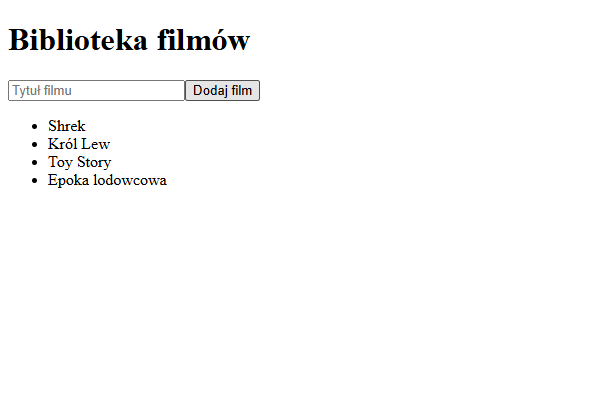

# Biblioteka filmów

Prosta aplikacja w React do wyświetlania i dodawania tytułów filmów do obejrzenia.

**Autor:** Konrad, nr 12

## Funkcje

- Po uruchomieniu wyświetlają się trzy domyślne filmy: „Shrek”, „Król Lew” i „Toy Story”.
- Można wpisać tytuł i kliknąć „Dodaj film”, aby dodać go na koniec listy.

## Technologie

- React
- Vite

## Uruchomienie

```bash
npm install
npm run dev
```

Aplikacja będzie dostępna pod adresem http://localhost:5173.

## Struktura

- `src/App.jsx` – główny komponent: stan filmów, input i przycisk „Dodaj film”
- `src/MovieList.jsx` – komponent wyświetlający listę filmów

## Screenshot


